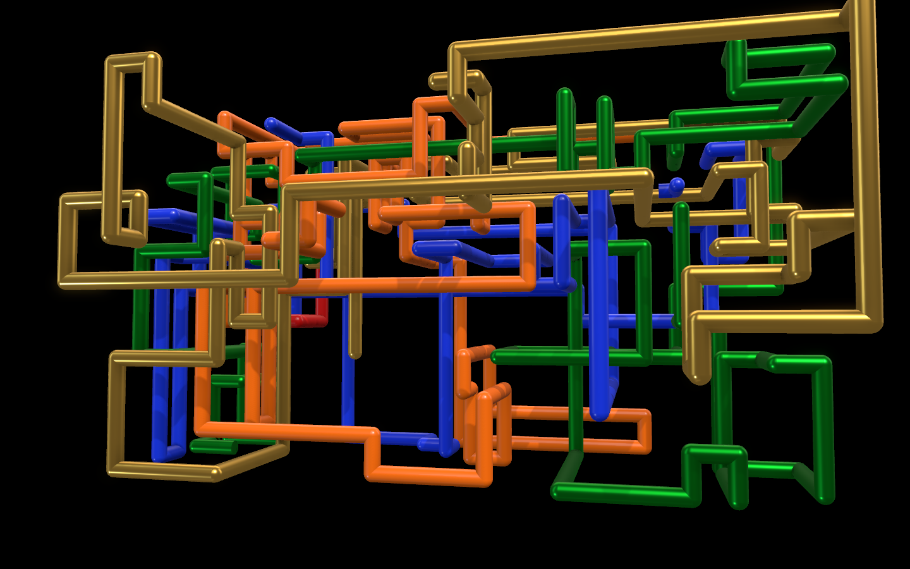
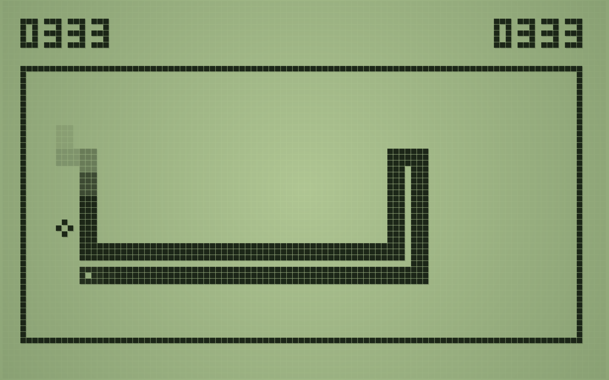

# Retro Screensavers for macOS and Windows

Two nostalgic screensavers, rebuilt natively for macOS (`.saver`) and Windows (`.scr`).

## Pipes

The 3D pipes you remember from late-90s office PCs, with a modern renderer.



- Kept: the black void, primary colours, ball joints and elbows, and the fade to black before a new tangle starts.
- New: glossy enamel, chrome, copper and brass materials with real reflections, soft shadows, smooth 60 fps growth and a slow camera drift.

## LCD Snake

A snake game that plays itself on an old monochrome phone display.



- The snake only takes the shortest route to the food if it can still reach its own tail afterwards, so it gets impressively long before it finally traps itself.
- Chunky LCD pixels with a faint grid, a soft shadow under lit pixels, and a ghosting trail like a slow old screen.
- Score on the left, best score of the session on the right.

## Install on macOS

1. Download `Retro-Screensavers-macOS.zip` from the [latest release](../../releases/latest) and unzip it.
2. Double-click `Pipes.saver` and `LCD Snake.saver`. macOS offers to install each one.
3. Open **System Settings → Screen Saver** and pick one. They are listed under **Other**, at the bottom.

Requires macOS 12 or later. Works on Apple silicon and Intel Macs.

### "Cannot be opened" or "could not verify" warning

These builds are signed locally but not notarised by Apple (that needs a paid developer account), so macOS may block them after download. Either:

- open **System Settings → Privacy & Security**, scroll down and click **Open Anyway**, or
- clear the download flag in Terminal before double-clicking:

```bash
xattr -dr com.apple.quarantine ~/Downloads/Pipes.saver ~/Downloads/"LCD Snake.saver"
```

If you would rather not trust a downloaded binary, build it yourself (below). It takes a few seconds.

### Every screensaver shows a black screen

This is a macOS bug, not specific to these savers: the background process that displays all screensavers gets stuck. Restart it, then quit and reopen System Settings:

```bash
killall WallpaperAgent
```

## Install on Windows

1. Download `Retro-Screensavers-Windows.zip` from the [latest release](../../releases/latest) and unzip it somewhere permanent (Windows runs the file from where it sits).
2. Right-click `Pipes.scr` or `LCD Snake.scr` and choose **Install**. To just try one, choose **Test** or double-click it.
3. Move the mouse or press a key to exit.

Works on 64-bit Windows 7 and later. No installer and nothing else to download.

The files are not code-signed, so Windows SmartScreen may say "Windows protected your PC". Click **More info → Run anyway**, or build it yourself from the source here.

The Windows version of Pipes uses classic OpenGL so it runs on any PC: same pipes, colours, gloss and chrome, without the soft shadows of the Mac version.

> The Windows builds are compiled and smoke-tested automatically on GitHub's Windows machines, but have not yet been tried on a wide range of real PCs. If something looks wrong, please open an issue.

## Build from source

**macOS** needs the Xcode Command Line Tools (`xcode-select --install`). No Xcode project required.

```bash
./build.sh
```

This produces `dist/Pipes.saver` and `dist/LCD Snake.saver`. The script also renders each saver offline to make its thumbnail, which doubles as a smoke test. Speeds, colours and grid sizes are constants near the top of `src/Pipes.m` and `src/Snake.m`.

**Windows** needs any MinGW-w64 gcc. A `.scr` is just a renamed `.exe`:

```bash
gcc -O2 -mwindows -static -o Pipes.scr windows/pipes.c -lopengl32 -lglu32 -lgdi32 -luser32
gcc -O2 -mwindows -static -o "LCD Snake.scr" windows/snake.c -lgdi32 -luser32
```

The [Windows build workflow](.github/workflows/windows.yml) does exactly this and is where the Windows release file comes from; the same workflow builds the Mac one.

## Privacy

Neither screensaver uses the network, reads files, or stores anything. On macOS they run inside Apple's sandboxed screensaver host.

## Uninstall

- macOS: delete `Pipes.saver` and `LCD Snake.saver` from `~/Library/Screen Savers`.
- Windows: pick another screen saver in Settings, then delete the `.scr` files.

## Licence

MIT. See [LICENSE](LICENSE).

These are original implementations made for fun. They are not affiliated with or endorsed by Microsoft or Nokia.
